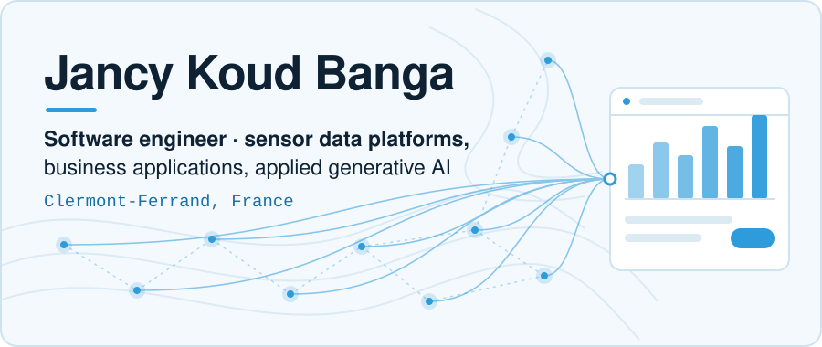
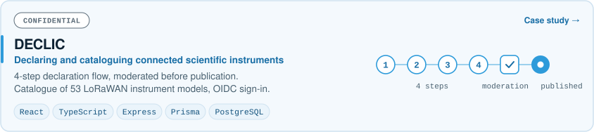
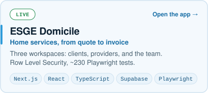
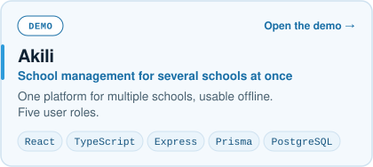
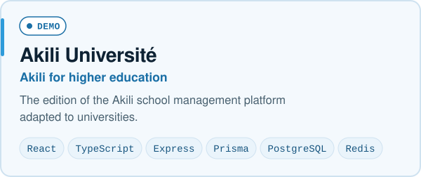
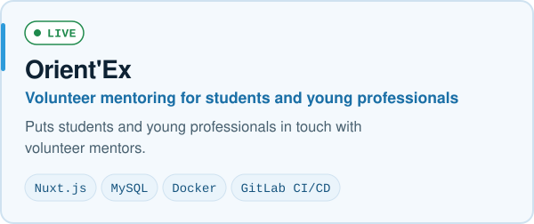
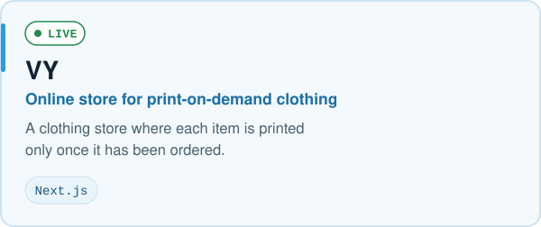
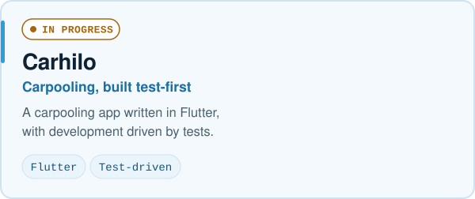

<picture>
  <source media="(prefers-color-scheme: dark)" srcset="assets/banner-dark.svg">
  
</picture>

  

I build web platforms that turn field data and business processes into products people can use, in three areas: sensor and environmental data, business applications, and applied generative AI.
A former mathematics teacher, I learn how the work is done before I write code, and I stay with a product from the first requirements through to support.

## About

- **Now** · building DECLIC for the ANR TERRA FORMA project (CNRS, INRAE, IRD, UCA).
- **Before** · final-year internship at Orange Data/AI (Angular, DataMesh); full-stack developer at GSI Concept.
- **Background** · two master's degrees from Montpellier: computer science, and information systems management.
- **Available** · January 2027, anywhere in France.

## What I work on

### Sensor & environmental data platforms

- Declaring and cataloguing connected scientific instruments.
- LoRaWAN sensors: low data rates, messages that arrive late.
- Open standards: OGC SensorThings on FROST-Server, INSPIRE / ISO 19115 metadata.
- Leaflet maps, and consistency checks on identifiers and coordinates.

**Shipped in:** [DECLIC](https://koud-portfolio.netlify.app/en/projects/declic), a catalogue of 53 LoRaWAN instrument models.

### Business applications, end to end

- Data model, API, interfaces, access rights, tests, and release to production.
- Built for specific trades: home services, school management, mentoring, e-commerce.
- Offline-capable apps, payments, document generation.

**Shipped in:** [ESGE Domicile](https://domicile.esgegroup.com), [Akili](https://edu-connect-web.vercel.app), [Akili Université](https://akili-universite.vercel.app), [Orient'Ex](https://orient-ex.org), [VY](https://vy-fawn.vercel.app).

### Applied generative AI

- Assistants wired to real content, not demos.
- My portfolio's assistant is built on the Claude API: streamed answers, a knowledge base generated from the site's content, rate limiting.
- Semantic search and RAG: embeddings, vector search with Qdrant.

**Shipped in:** KOUD AI, assistant of my portfolio (currently offline), and a [blog article on vector search](https://koud-portfolio.netlify.app/en/blog/qdrant-recherche-vectorielle).

## Featured work

<a href="https://koud-portfolio.netlify.app/en/projects/declic"><picture>
  <source media="(max-width: 600px) and (prefers-color-scheme: dark)" srcset="assets/card-declic-dark.svg">
  <source media="(max-width: 600px)" srcset="assets/card-declic-light.svg">
  <source media="(prefers-color-scheme: dark)" srcset="assets/card-declic-wide-dark.svg">
  
</picture></a>
<a href="https://domicile.esgegroup.com"><picture>
  <source media="(prefers-color-scheme: dark)" srcset="assets/card-esge-domicile-dark.svg">
  
</picture></a>
<a href="https://edu-connect-web.vercel.app"><picture>
  <source media="(prefers-color-scheme: dark)" srcset="assets/card-akili-dark.svg">
  
</picture></a>
<a href="https://akili-universite.vercel.app"><picture>
  <source media="(prefers-color-scheme: dark)" srcset="assets/card-akili-universite-dark.svg">
  
</picture></a>
<a href="https://orient-ex.org"><picture>
  <source media="(prefers-color-scheme: dark)" srcset="assets/card-orient-ex-dark.svg">
  
</picture></a>
<a href="https://vy-fawn.vercel.app"><picture>
  <source media="(prefers-color-scheme: dark)" srcset="assets/card-vy-dark.svg">
  
</picture></a>
<picture>
  <source media="(prefers-color-scheme: dark)" srcset="assets/card-carhilo-dark.svg">
  
</picture>

## Tech stack

| Area | Tools | Used in |
| :-- | :-- | :-- |
| **Frontend** | React, Next.js, TypeScript, Angular, Vue/Nuxt, Tailwind | DECLIC, ESGE Domicile (incl. Tailwind), Akili, VY, Orient'Ex (Nuxt), Orange Data/AI (Angular) |
| **Backend & APIs** | Node.js, Express, Python | DECLIC (Node.js, Express; Python scripts for data integration and validation), Akili (Node.js, Express) |
| **Data** | PostgreSQL, Prisma, Supabase, MySQL, Redis, Qdrant | DECLIC, ESGE Domicile (Supabase), Akili (Redis), Orient'Ex (MySQL), vector search article (Qdrant) |
| **AI** | Claude API, RAG, embeddings, vector search | KOUD AI (currently offline), vector search article |
| **IoT & standards** | LoRaWAN, OGC SensorThings, FROST-Server, INSPIRE | DECLIC |
| **Delivery & QA** | Docker, GitLab CI/CD, Playwright, Vitest | Orient'Ex (Docker, GitLab CI/CD), ESGE Domicile (Playwright, Vitest) |

## What's next

- AI agents that carry out business processes, not only answer questions about them.
- Sensor data that AI can work with directly, from the field measurement to the decision.
- Digital products for education in Africa.

## Activity

<picture>
  <source media="(prefers-color-scheme: dark)" srcset="https://streak-stats.demolab.com?user=jancykoud&hide_border=true&background=00000000&ring=2E9BDA&fire=2E9BDA&currStreakLabel=6CBDEA&currStreakNum=E8F0F6&sideNums=E8F0F6&sideLabels=A3B6C5&dates=A3B6C5&stroke=22394D">
  
</picture>

---

Looking for a software engineer from January 2027? [Get in touch through my portfolio](https://koud-portfolio.netlify.app/en/contact).

